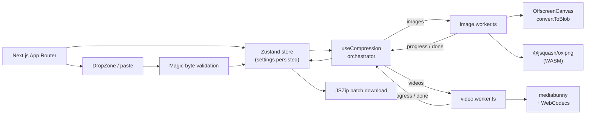

# LionMedia Compress

> Privacy-first image & video compression that runs **100% in your browser**. No uploads, no queues, no servers touching your files.

[](https://github.com/JeissonWeeDev/lion-compress-platform/releases)
[](https://nextjs.org)
[](https://react.dev)
[](https://www.typescriptlang.org)
[](https://tailwindcss.com)
[](#testing)
[](./LICENSE)

---

## Why this project exists

Most “free” media compressors work by uploading your files to a remote server. That means your screenshots, client assets, unreleased designs, or personal videos leave your machine.

**LionMedia Compress inverts that model.** The whole pipeline — validation, decoding, encoding, and packaging — happens on the client using WebAssembly, Web Workers, and WebCodecs. The file never leaves the browser tab.

The result is a tool that is:

- **Private by architecture**, not by policy.
- **Fast**, because there is no upload/download round-trip.
- **Free to operate**, because there is no compression backend to pay for.

---

## Features

- **Drag & drop, file picker, and clipboard paste** (`Ctrl/⌘ + V`).
- **Magic-byte validation** — file types are verified from their binary signature, not just the extension.
- **Image compression** for JPEG, PNG, WebP, and AVIF.
  - PNG → PNG uses `@jsquash/oxipng` (lossless WASM optimizer).
  - Other paths use `OffscreenCanvas` + `convertToBlob`.
- **Video compression** for MP4, WebM, and MOV via `mediabunny` + the WebCodecs API.
  - Lossless mode performs a **transmux** (packet copy, no re-encode).
  - Balanced/custom modes re-encode at a mapped quality level.
- **Three compression modes:** `lossless`, `balanced`, and `custom` (quality slider).
- **Output format control:** keep the source format or convert to WebP, AVIF, JPEG, or PNG.
- **Metadata stripping** toggle.
- **Batch processing** with bounded concurrency: 2 images at a time, 1 video at a time.
- **Individual download** or **download all as a ZIP** (`JSZip`).
- **Bilingual UI (ES/EN)** with automatic locale detection.
- **Light / dark theme** with system preference support.

---

## Architecture



### Compression pipeline

1. **Intake** — files arrive from drag & drop, the picker, or the paste hook.
2. **Validation** — `getFileMimeFromMagicBytes()` reads the first bytes and accepts only known image/video signatures. Mismatches are rejected before any work starts.
3. **Queueing** — accepted files are stored in Zustand with a stable `nanoid`, status, and progress. Settings are the only thing persisted to `localStorage`; file blobs are intentionally kept in memory.
4. **Orchestration** — `useCompression()` owns the workers and enforces concurrency limits. Processing starts only when the user explicitly clicks **Compress**.
5. **Processing (off the main thread)**
   - Images run in `workers/image.worker.ts`.
   - Videos run in `workers/video.worker.ts`.
6. **Results** — the worker returns a compressed `Blob`, byte size, savings percentage, output format, and elapsed time. The UI can download files individually or as a ZIP.

### Key engineering decisions

| Decision                                            | Rationale                                                                                                                            |
| --------------------------------------------------- | ------------------------------------------------------------------------------------------------------------------------------------ |
| **Web Workers for all encoding**                    | Keeps the UI at 60 fps and prevents long tasks from blocking input.                                                                  |
| **WASM (`oxipng`) only for PNG → PNG**              | Lossless optimization gives real savings without re-encoding artifacts; the module is lazy-loaded so it is only fetched when needed. |
| **`OffscreenCanvas` for lossy images**              | Native, GPU-friendly, and available inside workers — no DOM required.                                                                |
| **`mediabunny` + WebCodecs for video**              | Hardware-accelerated encoding and true transmux support without shipping an ffmpeg-sized bundle.                                     |
| **Zustand with selective persistence**              | Settings survive reloads; user media never touches disk.                                                                             |
| **Pure helpers in `src/lib/compression/engine.ts`** | MIME/quality/PNG-level logic is framework-free and fully unit-tested.                                                                |
| **Locale via `proxy.ts`**                           | Reads the `locale` cookie, then `Accept-Language`, and falls back to the default locale.                                             |
| **Bounded concurrency**                             | 2 images / 1 video avoids saturating low-end devices while keeping throughput reasonable.                                            |

---

## Tech stack

| Layer             | Technology                                                                             |
| ----------------- | -------------------------------------------------------------------------------------- |
| Framework         | [Next.js 16](https://nextjs.org) (App Router)                                          |
| UI                | React 19, Tailwind CSS 4, Framer Motion, Lucide icons                                  |
| State             | [Zustand 5](https://zustand.docs.pmnd.rs) with `persist`                               |
| Images            | [`@jsquash/oxipng`](https://github.com/jamsinclair/jSquash) (WASM) + `OffscreenCanvas` |
| Video             | [`mediabunny`](https://mediabunny.dev) + WebCodecs                                     |
| Files             | `JSZip`, `nanoid`, `clsx`                                                              |
| Themes            | `next-themes`                                                                          |
| i18n              | Custom dictionary-based provider (ES/EN)                                               |
| Testing           | [Vitest](https://vitest.dev) + Testing Library                                         |
| Systems reference | Rust (`native/engine-core`, not part of the runtime)                                   |
| Quality           | ESLint (flat config), Prettier, TypeScript strict mode                                 |

---

## Getting started

### Prerequisites

- **Node.js 20+** (or **Bun 1.1+**, recommended — the repo ships a `bun.lock`).
- A modern Chromium-based browser for full video support (see [Browser support](#browser-support)).

### Install & run

```bash
bun install      # or: npm install
bun run dev      # or: npm run dev
```

Open [http://localhost:3000](http://localhost:3000).

### Production build

```bash
bun run build
bun run start
```

> The build uses the webpack pipeline (`next build --webpack`). See `next.config.ts` for the WASM asset rule that avoids a known webpack chunk-graph deadlock with `@jsquash/oxipng`.

---

## Scripts

| Script         | Description                             |
| -------------- | --------------------------------------- |
| `dev`          | Start the Next.js dev server.           |
| `build`        | Create a production build with webpack. |
| `start`        | Serve the production build.             |
| `lint`         | Run ESLint across the repo.             |
| `typecheck`    | Run `tsc --noEmit`.                     |
| `test`         | Run Vitest in watch mode.               |
| `coverage`     | Run Vitest once with coverage.          |
| `format`       | Format the repo with Prettier.          |
| `format:check` | Verify formatting without writing.      |

---

## Project structure

```text
.
├── src/
│   ├── app/                  # App Router: layout, page, legal routes, AppShell
│   ├── components/
│   │   ├── common/           # Language & theme toggles
│   │   ├── drop-zone/        # File intake + validation UI
│   │   ├── file-list/        # Queue, progress, downloads, ZIP export
│   │   ├── layout/           # Header, footer, container, background
│   │   ├── settings/         # Mode / quality / format controls
│   │   └── ui/               # Buttons, badges, progress, orb, etc.
│   ├── dictionaries/         # ES/EN JSON dictionaries
│   ├── hooks/                # useCompression, usePaste
│   ├── lib/
│   │   ├── compression/      # Pure engine helpers, presets, worker types, tests
│   │   ├── i18n/             # Locale detection + dictionary provider
│   │   └── utils/            # Byte formatting, browser support, magic bytes
│   ├── store/                # Zustand app store
│   ├── types/                # Shared TypeScript contracts
│   └── proxy.ts              # Locale middleware (Next.js 16 proxy)
├── workers/
│   ├── image.worker.ts       # Image compression worker
│   └── video.worker.ts       # Video compression worker
├── native/
│   └── engine-core/          # Rust reference implementation of the engine
├── tests/setup.ts            # Vitest setup
└── public/                   # Static assets
```

---

## Testing

The compression engine is deliberately split into pure functions so it can be tested without a browser:

```bash
bun run test        # watch mode
bun run coverage    # single run + coverage
```

Current coverage focuses on:

- Output MIME resolution (`same` vs explicit formats).
- Quality resolution across `lossless`, `balanced`, and `custom` modes.
- PNG optimization-level mapping.
- Savings calculation, including zero-size and non-improving edge cases.

**29 tests pass** across the engine suite.

### Rust reference module

`native/engine-core/` is a dependency-free Rust crate that mirrors the pure
compression helpers (MIME resolution, quality mapping, PNG level, savings math,
byte formatting, and magic-byte detection). It exists as a systems-level
reference and a parity harness; it is **not** imported by the Next.js build and
does not affect production behavior.

```bash
cd native/engine-core
cargo fmt --check
cargo clippy --all-targets -- -D warnings
cargo test
```

The crate forbids `unsafe` code, has no third-party dependencies, and ships
**46 tests** (unit, integration, and doc tests). See
[`native/engine-core/README.md`](./native/engine-core/README.md) for details.

---

## Browser support

| Capability         | Requirement                                                                            |
| ------------------ | -------------------------------------------------------------------------------------- |
| Image compression  | WebAssembly + `OffscreenCanvas` (all modern browsers).                                 |
| Video compression  | WebCodecs (`VideoEncoder`/`VideoDecoder`) — Chromium-based browsers and recent Safari. |
| Paste intake       | `navigator.clipboard` / paste events.                                                  |
| File System Access | Optional, detected at runtime.                                                         |

Unsupported capabilities are detected through `src/lib/utils/browser-support.ts` rather than assumed.

---

## Privacy & security model

- **No uploads.** All processing happens in the browser. There is no compression API.
- **In-memory media.** File blobs live in the Zustand store and are discarded when the tab closes.
- **Settings only in `localStorage`.** Preferences (mode, format, locale) are persisted; media never is.
- **Signature-based validation.** Magic bytes prevent disguised or unsupported files from entering the pipeline.
- **Least-privilege i18n cookie.** The `locale` cookie is `sameSite=lax` and intentionally not `httpOnly`, because the client toggle reads it.

---

## Roadmap

- [ ] Before/after visual comparison slider.
- [ ] Optional max-width / max-height resizing controls (types already defined).
- [ ] Pluggable ad adapter (types drafted in `src/types/ads.ts`).
- [ ] PWA / offline support.
- [ ] Additional container conversions for video.
- [ ] End-to-end tests for worker pipelines.

---

## License

Distributed under the **Apache License 2.0**. See [`LICENSE`](./LICENSE) for details.

---

## Author

**Jeisson Leon** — [@JeissonWeeDev](https://github.com/JeissonWeeDev)

Built with a focus on privacy, performance, and a clean client-side architecture.
